<div align="center">

# Synthesis

**A native macOS studio for building fictional worlds.**
Write freely, connect everything, and let an assistant help without ever rewriting your canon.

[](https://github.com/desenyon/synthesis/releases/latest)
[](https://github.com/desenyon/synthesis/actions/workflows/ci.yml)


[](LICENSE)

[Download](https://github.com/desenyon/synthesis/releases/latest) · [Features](#features) · [Build from source](#build-from-source) · [Documentation](docs/README.md) · [Changelog](CHANGELOG.md)

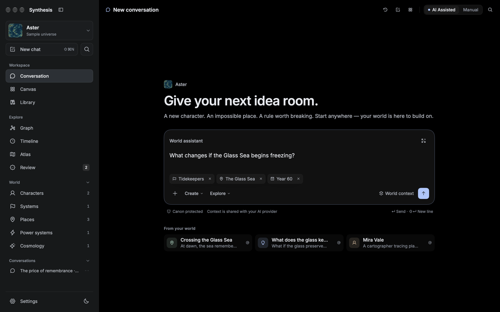

</div>

## Why Synthesis

Most worldbuilding tools are either a pile of notes or a rigid wiki. Synthesis treats a world as one connected database: a character on the Canvas is the same record you edit in the Library, place on the Atlas, cite on the Timeline and see in the Graph.

- **Creative flow first.** Dump an idea without a template. Organise it later.
- **Canon is deliberate.** Ideas, drafts, proposals and accepted canon stay distinct. Nothing becomes canon until you accept an exact revision.
- **Local and private.** Everything lives in a local SQLite database. No account, no cloud sync, no telemetry.
- **Assistance on your terms.** AI Assisted or Manual, switchable anywhere. Assistance runs through your own Claude Code or Codex subscription, with no tools or file access.
- **Portable.** Export a world as a `.synthesis` file, Markdown or JSON at any time.

## Features

| | |
| --- | --- |
| **Conversation**: attach lore, boards, maps and history; inspect context before sending. Explore ideas or propose reviewable changes, with `@` references and control over what the assistant reads. | **Canvas**: an offline [Excalidraw](https://github.com/excalidraw/excalidraw) board where record cards stay linked to your library and relationships draw themselves. |
| 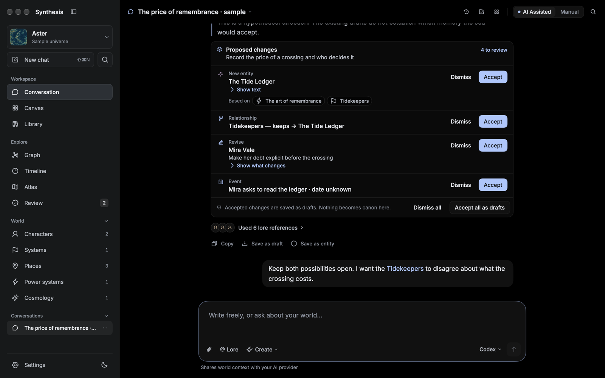 | 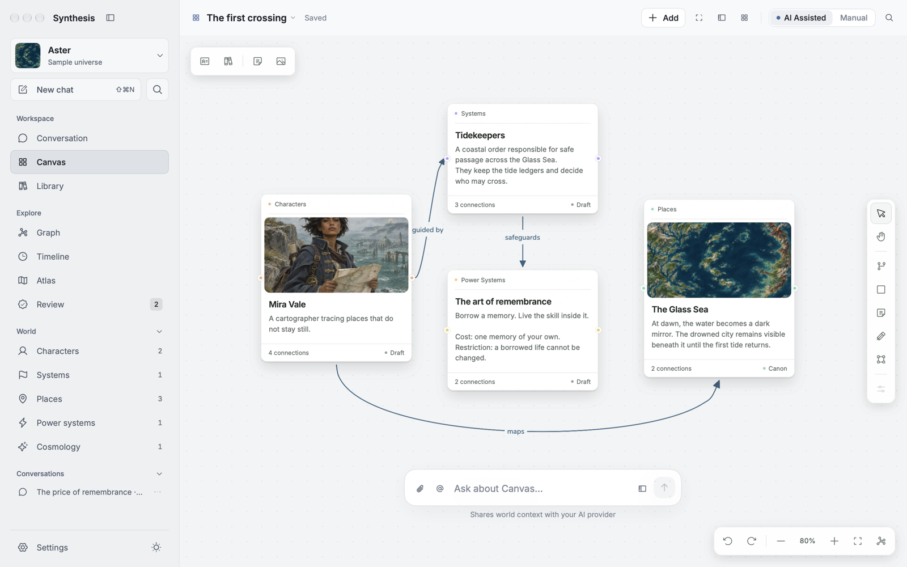 |
| **Graph**: the relationship network, laid out automatically from stored data. Zoom from compact titles to summaries and stored artwork. Copy any neighbourhood onto a board. | **Library and editor**: rich text, tags, aliases, links, sections and a details inspector, with canon review as a line diff. |
| 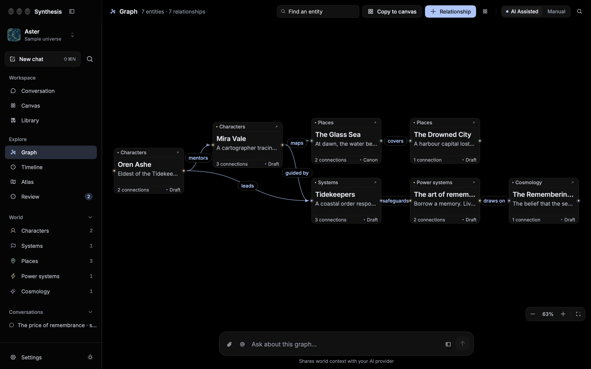 | 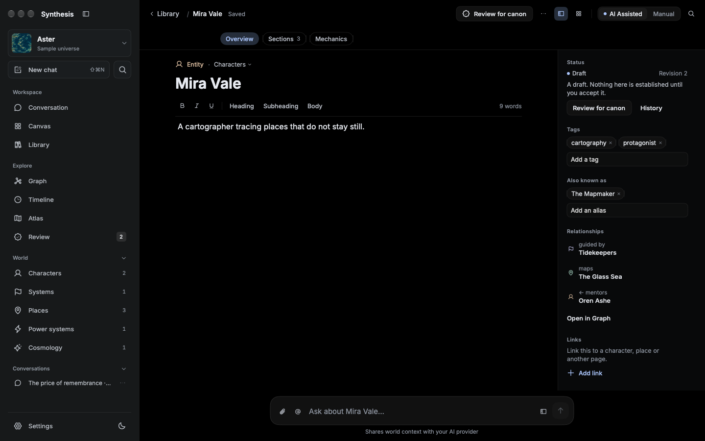 |
| **Mechanics**: rules, costs, limits and scenarios for power systems, plus a technique tree built from what each technique requires. | **Timeline**: sourced events with free-form dates, nested branches and periods, and Detailed, Compact or By-era views. |
| 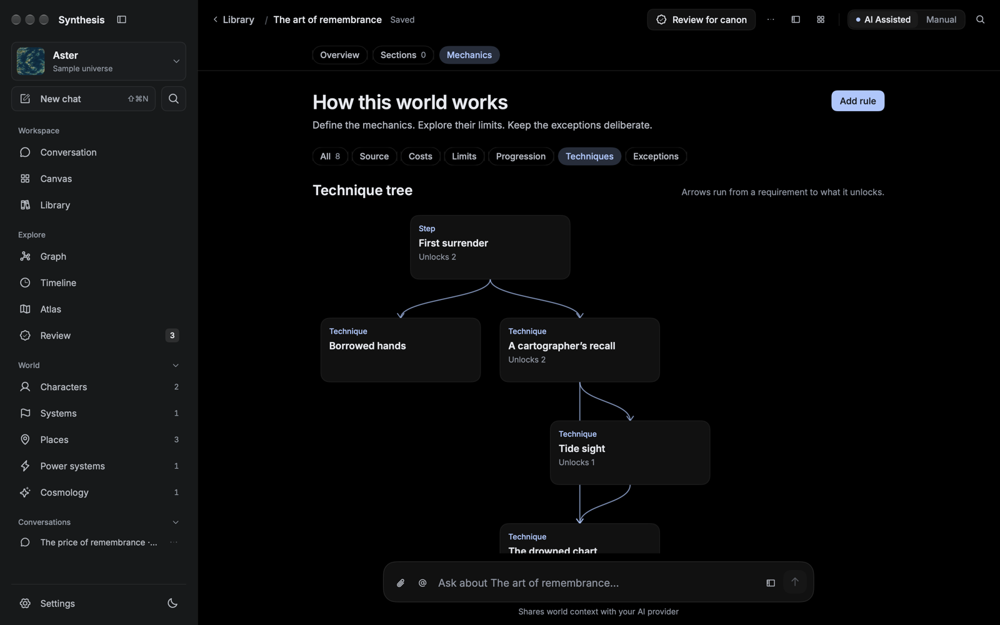 | 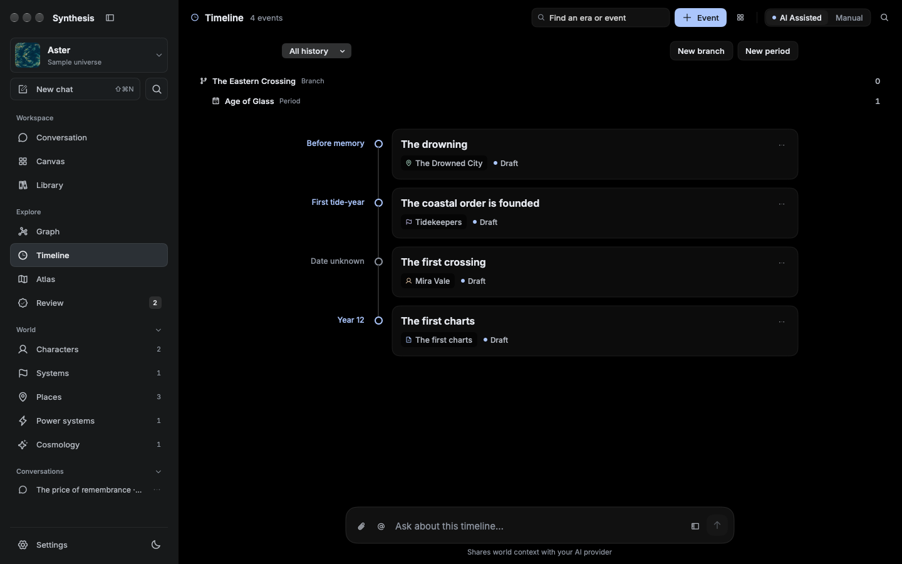 |
| **Atlas**: named maps linked to places, with markers and drawn regions you can reshape. | **Review**: proposals, canon decisions and local consistency checks in one place, including changes sent back from what-if worlds. |
|  | 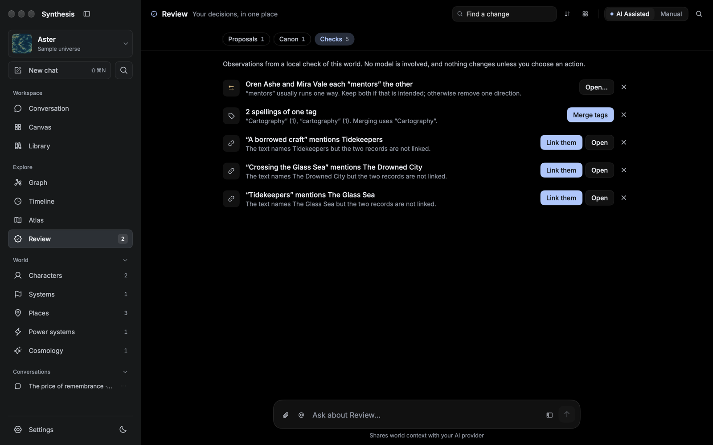 |

**Also:** a world dashboard with project outlines · saved workspace layouts (⌥⌘L) · reversible navigation history · optional contextual inspectors · adjustable information density · portable entity artwork · what-if worlds that merge back through review · entity sections and creative components (notes, facts, checklists, progression) · reversible archive with Undo everywhere · crash recovery for unsaved text · searchable Settings · a ⌘K command palette · Finder integration for `.synthesis` files.

<details>
<summary>More screenshots</summary>

**Inspect context before sending**

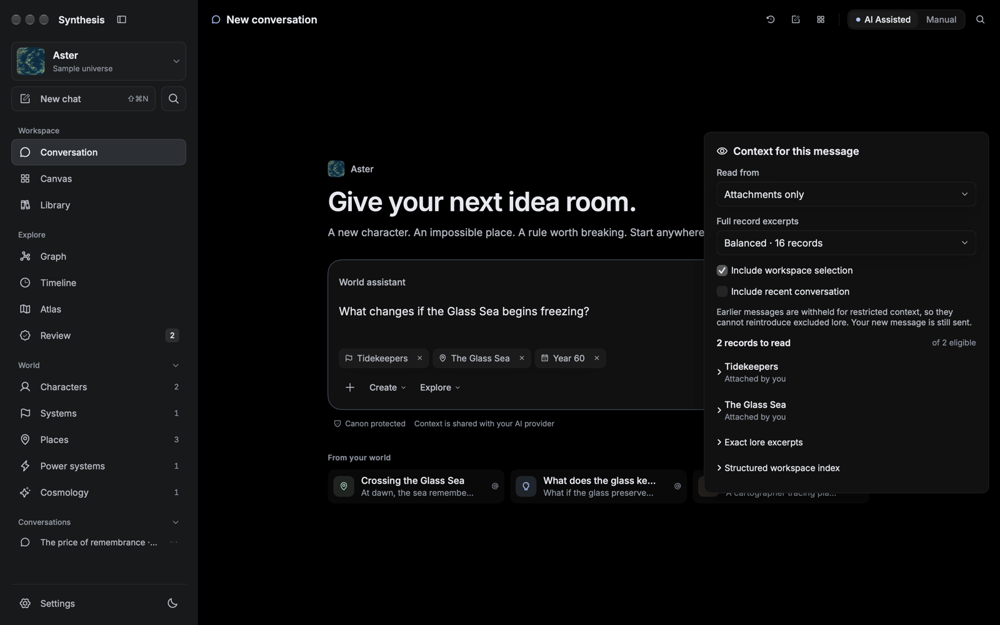

**Pick up your world**

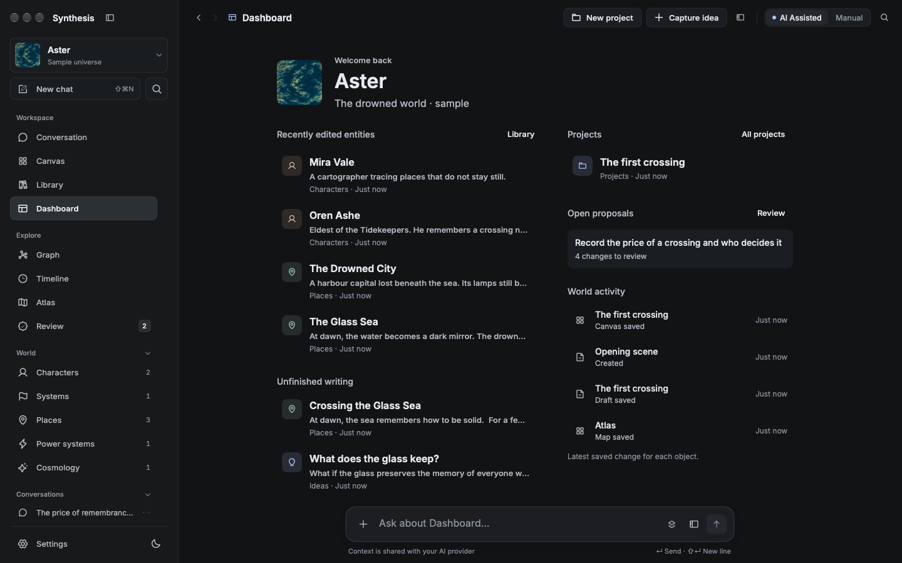

**Graph detail from stored lore**

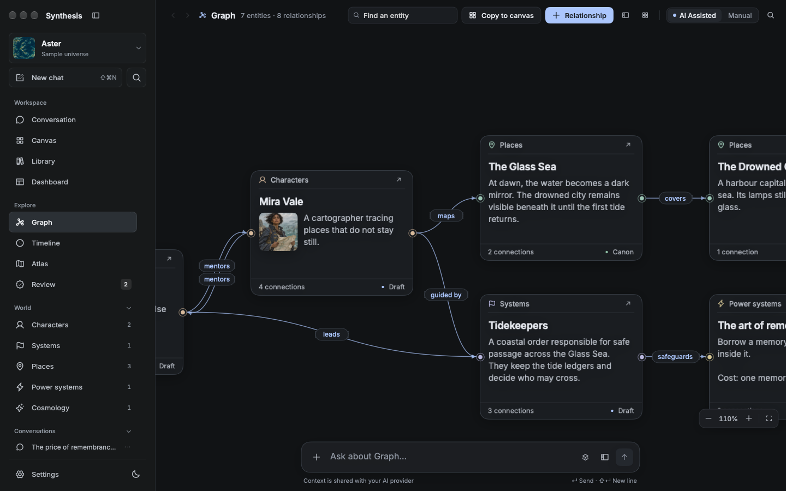

**Saved workspace layouts**

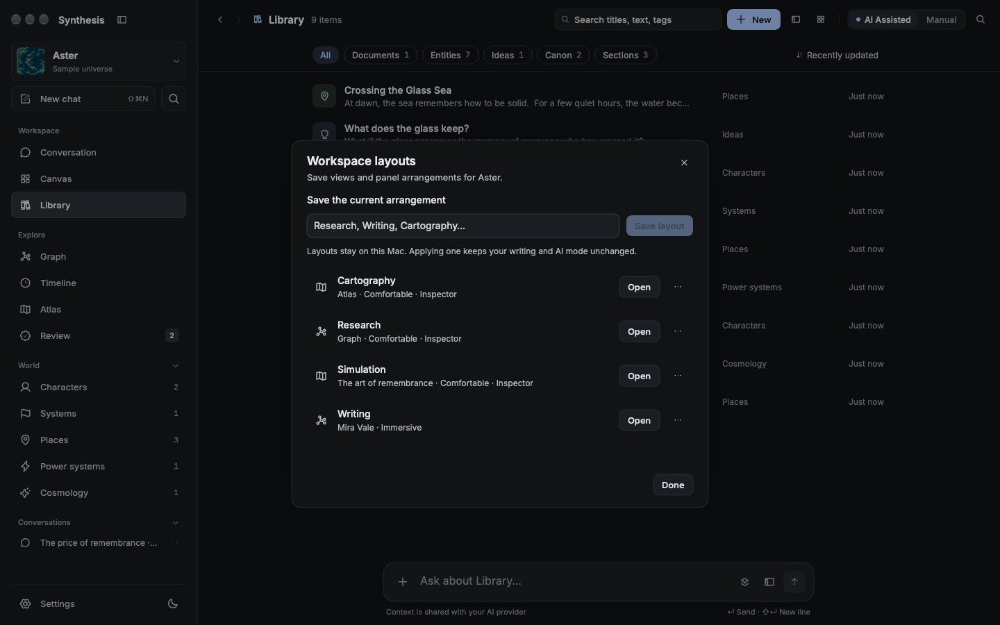

**Canvas with real relationships**


**What-if changes in Review**

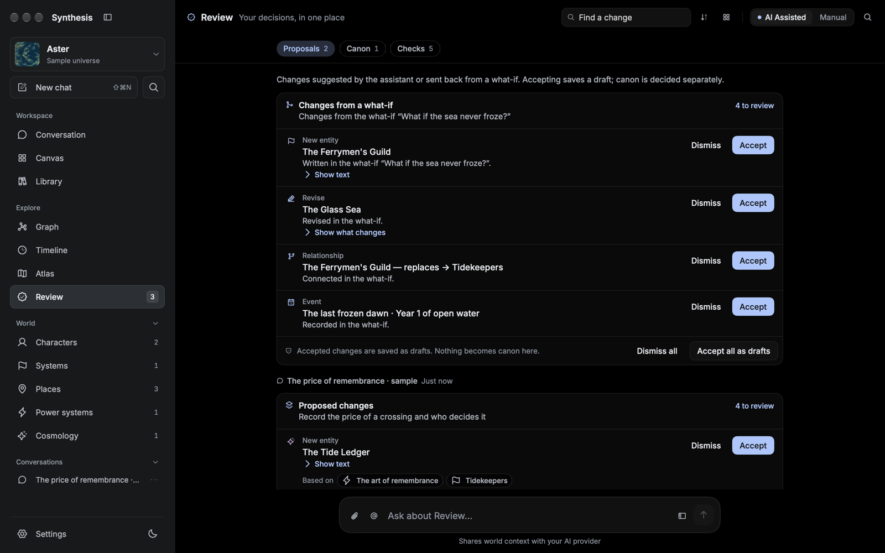

**Settings**

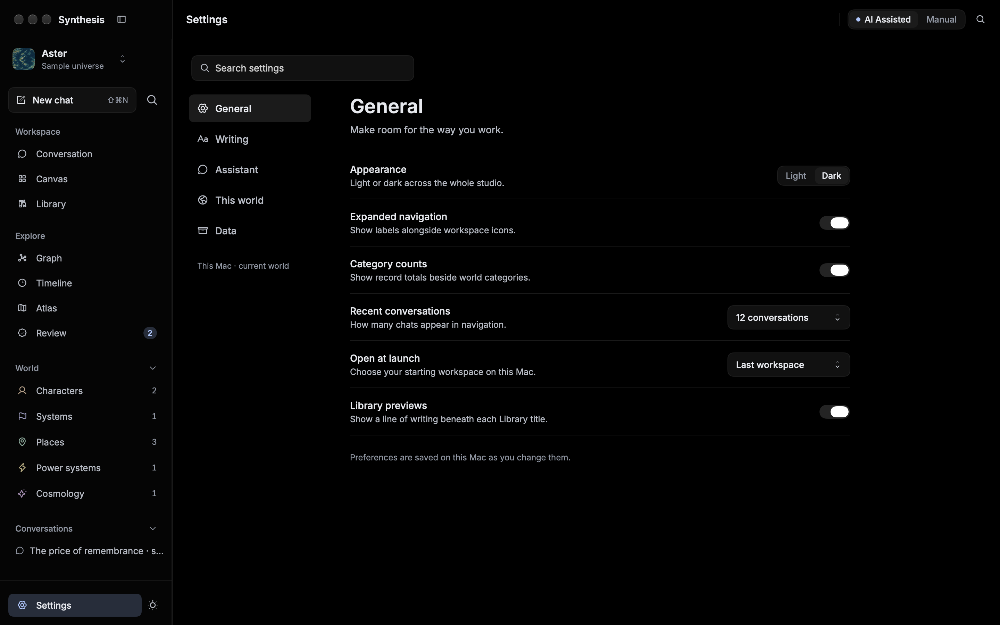

</details>

Screenshots are the real app with the bundled **Aster** sample world at 1440×900. Composer, context, Conversation, light Canvas, detailed Graph, Dashboard and workspace-layout images were refreshed on November 17 for **unreleased main** after 0.0.3; other screens show the 0.0.3 capture set. [Capture details](docs/screenshots/README.md).

The complete 394-item expansion is tracked individually in [the implementation ledger](docs/EXPANSION.md). It is **not yet complete**. Dark surfaces now default to graphite; **Settings → General → Dark surfaces** retains true-black OLED as an option.

## Install

1. Download `Synthesis-<version>-macos-arm64.zip` from the [latest release](https://github.com/desenyon/synthesis/releases/latest).
2. Unzip and move **Synthesis.app** to Applications.
3. The app is ad-hoc signed and **not notarized**, so macOS blocks the first launch. Open it once, then choose **System Settings → Privacy & Security → Open Anyway**.

Requires Apple Silicon and macOS 14 or later. Verify the download with the release's `SHA256SUMS.txt`.

## Build from source

```sh
git clone https://github.com/desenyon/synthesis.git
cd synthesis
./scripts/build.sh release
open dist/Synthesis.app
```

Requires macOS 14+ and Xcode 26 (or the Swift 6 Command Line Tools with the macOS 26 SDK). The Canvas web bundle is committed; Node is only needed to change it (`cd CanvasWeb && npm install && npm run build`).

Your data lives in `~/Library/Application Support/Synthesis/synthesis.sqlite`. Set `SYNTHESIS_DATABASE_PATH` to use another file.

## Assistant setup

Synthesis talks to **Codex** (ChatGPT subscription) or **Claude Code** (Claude subscription) installed on your Mac. There are no API keys to enter: sign in to the CLI once (`codex login`, or run `claude`), then pick it in **Settings → Assistant**. Each request runs in an empty scratch folder with tools, file access and your CLI configuration disabled. Manual mode blocks every request in the core. Details: [AI setup](docs/AI_SETUP.md).

In the composer, **+** attaches real world context and **World context** previews the excerpts and index locally. **Explore** cannot stage changes; **Propose** sends validated draft operations to Review. Restricted scopes omit earlier chat messages, and explicit canon approval remains separate. [Composer guide](docs/COMPOSER_CONTEXT.md).

The same expanding composer follows you into workspace companions. Its toolbar adapts to narrow panels, attachments wrap, and the footer shows your chosen send shortcut. Change Enter/⌘Enter in **Settings → Writing**.

## Keyboard shortcuts

| Shortcut | Action |
| --- | --- |
| ⌘K | Search and commands |
| ⌘1 – ⌘7 | Conversation, Canvas, Library, Graph, Timeline, Atlas, Review |
| ⌘8 / ⌘9 | Worlds / Settings |
| ⌘N / ⇧⌘N | New record / new conversation |
| ⌘O / ⇧⌘S | Open / save a `.synthesis` world file |
| ⇧⌘I | Import Markdown or text files |
| ⇧⌘M | Toggle AI Assisted / Manual |
| ⌘\ | Toggle navigation |
| ⌘[ / ⌘] | Back / Forward |
| ⌥⌘I | Contextual inspector |
| ⌥⌘L | Saved workspace layouts |
| `@` in a message | Reference lore (↑↓ choose, ↵ insert) |

Canvas also supports Excalidraw's own shortcuts (V select, H hand, A arrow, ⌘D duplicate, ⌘G group).

## Development

```sh
./scripts/check.sh                       # strict lint, tests, optimized build
./scripts/verify-ui.sh /tmp/captures     # renders every app state in the background
./scripts/selftest-ui.sh /tmp/selftest   # real pointer and key events (takes focus briefly)
cd CanvasWeb && npm test && npm run typecheck
```

The code is split into `SynthesisCore` (SQLite persistence, canon, proposals, retrieval and the subscription harness), `SynthesisUI` (SwiftUI workspaces and the design system) and `CanvasWeb` (the Excalidraw integration). Start with [Architecture](docs/ARCHITECTURE.md), [Product](docs/PRODUCT.md) and the [documentation index](docs/README.md). Coding agents should read [AGENTS.md](AGENTS.md) first.

## Project status

Synthesis is in early releases (0.0.x): usable and tested on the development Mac, but not yet the 1.0 launch. Current state and verification: [STATE](docs/STATE.md). What's next: [ROADMAP](docs/ROADMAP.md). Release history: [CHANGELOG](CHANGELOG.md).

## Contributing

Issues and pull requests are welcome. Please read [CONTRIBUTING](CONTRIBUTING.md) and the [Code of Conduct](CODE_OF_CONDUCT.md). Report security problems privately as described in [SECURITY](SECURITY.md).

## License

Synthesis is free software under the [GNU General Public License v3.0](LICENSE). Bundled third-party components (Excalidraw, Dagre, Phosphor icons, Inter) keep their own licenses; see [THIRD_PARTY](THIRD_PARTY.md).
