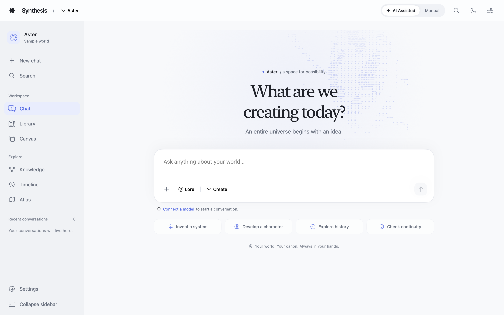

# Synthesis

A native macOS creative studio for fictional worlds. Conversation first, light by default, with an independent Manual workspace. **Development only; no releases.**



## Run locally

macOS 14+, Apple Command Line Tools with Swift 6. The application uses **SwiftUI + AppKit**, SQLite and native rich text. It does not use GPUI or a WebView. No third-party runtime packages are required.

```sh
export EDITOR=vim VISUAL=vim GIT_EDITOR=vim
./scripts/build.sh
open dist/Synthesis.app
```

The build selects the installed macOS 26.5 SDK when present because this machine's default 27 SDK needs a SwiftUI macro plugin absent from Command Line Tools. The bundle is ad-hoc signed for local development, not notarized or distributed.

## What works

- Light chat home, collapsible navigation, persistent warm dark theme, native menu shortcuts and ASCII orbital artwork.
- Worlds, persisted conversation history, rename/search, text attachments and lore references. OpenAI Responses streaming adapter with cancellation; connection is optional. Missing-provider messages are saved and displayed honestly.
- Manual mode blocks provider requests in the core and cancels active operations. A separate studio replaces chat.
- Capture inbox, documents and entities; native rich-text editing, autosave, revision history, categories, tags, aliases, source links/backlinks and world-scoped full-text search.
- Explicit exact-version canon review. Draft edits retain accepted canon; the model cannot approve changes.
- Stored entity relationship graph and a source-linked event timeline with uncertain dates and optional ordering.
- Canvas notes, images and linked records; dragging, resizing, connectors, grouping, zoom/pan, session undo/redo and persistence.
- Atlas PNG/JPEG upload, linked markers, zoom/pan and persistence. No map is assumed or generated automatically.
- Markdown document export and versioned world JSON export.

These are development implementations. See [STATE](docs/STATE.md) for exact observed tests and remaining limits. Rich chat tables/images, structured multi-record AI proposals, branch management, custom calendars and broader accessibility/performance validation remain unfinished.

## A first worldbuilding session

1. Open the world menu beside **Synthesis**, choose **Create world**, and name it.
2. Switch to **Manual**, choose **Capture an idea**, and write without a template. Saves happen locally; ⌘S flushes immediately.
3. In the document's **…** menu choose **Turn into document**. The original record and history survive.
4. Use **New document**, select **Entity**, and create a character or place. Open the page's link button to connect it to that entity; tags and aliases live in the same inspector.
5. Press **⌘K**, search for a phrase or alias, and reopen the page. Follow its linked record, or the entity's incoming reference.
6. Add a typed entity relationship in **Knowledge**, or create a sourced event in **Timeline**. Both open actual library records.
7. Switch to **AI Assisted** for conversation. Configure a provider only if you want external AI. An answer can be saved as an AI-origin draft and reviewed separately before canon promotion.

**Aster** is an opt-in, clearly labeled sample world available from the world menu. It never replaces your own records.

## Storage and privacy

The database is `~/Library/Application Support/Synthesis/synthesis.sqlite`. Migrations run automatically on opening it. `SYNTHESIS_DATABASE_PATH` selects an isolated database for development. SQLite WAL/shm files belong with the active database; quit the app before making a raw file backup. Prefer the world JSON export for portable content.

API keys live in macOS Keychain, not repository files or the database. Sending a message explicitly shares that message and bounded selected-world context with the configured OpenAI model. There are no background model calls. See [AI setup](docs/AI_SETUP.md).

The superseded web scaffold is preserved under `legacy/web/`; earlier `docs/design/*.html` are historical rejected studies. Neither is the running application.

## Checks

```sh
./scripts/test.sh                    # Swift Testing: persistence and safety boundaries
swift format lint --strict --recursive Sources Tests Package.swift
./scripts/build.sh release           # optimized local development build, not a release
./scripts/check.sh                   # lint + tests + optimized build
./scripts/verify-ui.sh               # real native renders, isolated sample database
uv run --with pillow python scripts/contact-sheets.py docs/verification/latest
```

The screenshot harness renders six actual native application states at 1440×900, 1920×1080, 1024×768 and 390×844 logical points, plus secondary desktop views. It verifies viewport dimensions. These are macOS layouts, not browser/iOS tests. It does not call an AI provider; the active-chat fixture truthfully shows an unavailable-provider conversation.

Use `vim` to edit configuration and source. [Product](docs/PRODUCT.md) · [Architecture](docs/ARCHITECTURE.md) · [Roadmap](docs/ROADMAP.md) · [Decisions](docs/DECISIONS.md) · [Verification](docs/verification/WALKTHROUGH.md)
