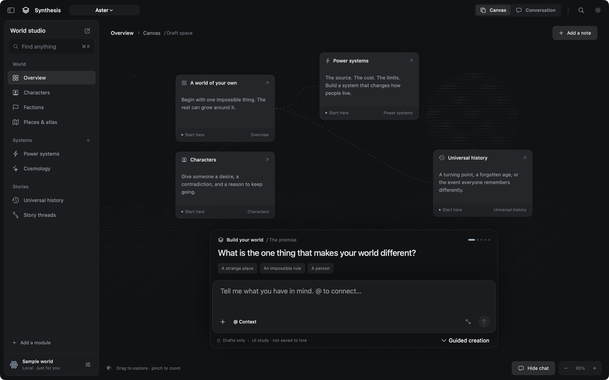

# Synthesis

A native macOS worldbuilding studio. **Current milestone: UI design and interaction review.** Application feature expansion is paused until the interface direction is accepted.

The latest UI replaces the earlier light editorial design with a graphite infinite canvas, compact modular navigation, a floating guided-chat composer, and an integrated draggable header. There is no separate macOS title bar, fake window chrome or embedded webpage.



## Run the UI study

```sh
export EDITOR=vim VISUAL=vim GIT_EDITOR=vim
./scripts/build.sh release
open dist/Synthesis.app
```

Requires macOS 14+ and Apple Command Line Tools with Swift 6. The implementation is **SwiftUI + AppKit**, a native alternative to GPUI. The build scripts select the compatible installed SDK. The optimized bundle is ad-hoc signed for local development; no release is being made.

## Review the interactions

- Drag the open canvas or scroll to pan; pinch or use the zoom controls to change scale.
- Drag cards; click a starter to enter its creation guide.
- Use **Power systems**, **Universal history**, **Characters**, and other sidebar modules. Each guide asks relevant questions and turns answers into working fragments.
- Switch between **Canvas** and **Conversation** in the header.
- Add a custom module, search with ⌘K, create a note with ⌘N, or click a fragment to edit it.
- Collapse the module panel; hide/show chat; expand the composer; switch appearance.
- Drag the empty area of the top strip to move the window. ⌘W closes it; ⌘Q quits.

This is a **local UI walkthrough**, not a connected AI session. Guide prompts are authored interface copy, not fabricated model responses. Working fragments remain in memory and are not saved to lore or canon. Existing user content is preserved. The previously implemented persistent application remains in source and in commit `f35e968`; it is not the current review surface.

## Design and evidence

[Native review evidence](docs/verification/UI_REVIEW.md) · [Current UI direction](docs/UI_DIRECTION.md) · [Current state](docs/STATE.md) · [Roadmap](docs/ROADMAP.md) · [Decisions](docs/DECISIONS.md)

The new design follows the latest supplied canvas/module/chat references. Earlier `docs/design/*.html` and `docs/verification/round1` / `round2` are superseded studies, not the current UI.

## Development checks

```sh
./scripts/test.sh
swift format lint --strict --recursive Sources Tests Package.swift
./scripts/build.sh release
./scripts/verify-ui.sh
uv run --with pillow python scripts/contact-sheets.py docs/verification/latest
```

Native screenshots cover canvas, guided conversation, power-system module, fragment detail, collapsed navigation and light appearance. They are rendered at four exact logical sizes, not in a browser. The screenshot harness uses a separate sample database and does not call a provider.

The preserved application data lives in `~/Library/Application Support/Synthesis/synthesis.sqlite`. `SYNTHESIS_DATABASE_PATH` overrides it for isolated development. Provider credentials remain in Keychain; the current UI study never uses them. Historical backend and setup information: [Architecture](docs/ARCHITECTURE.md), [AI setup](docs/AI_SETUP.md), [previous native walkthrough](docs/verification/WALKTHROUGH.md).
