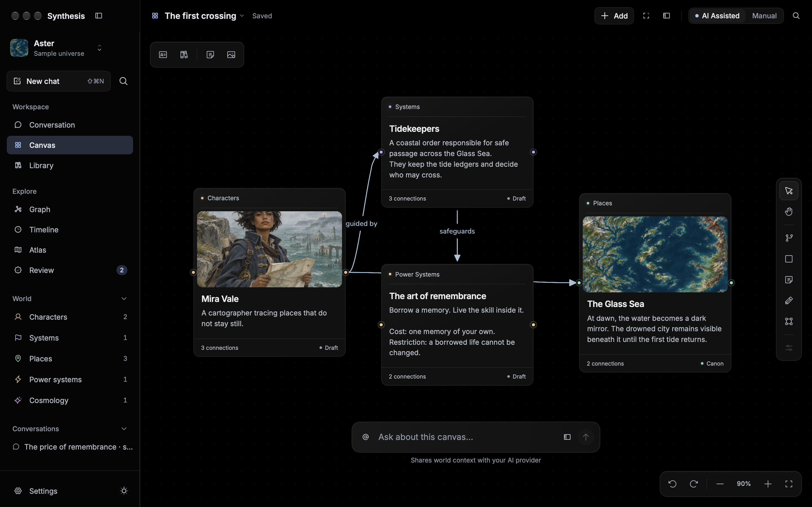
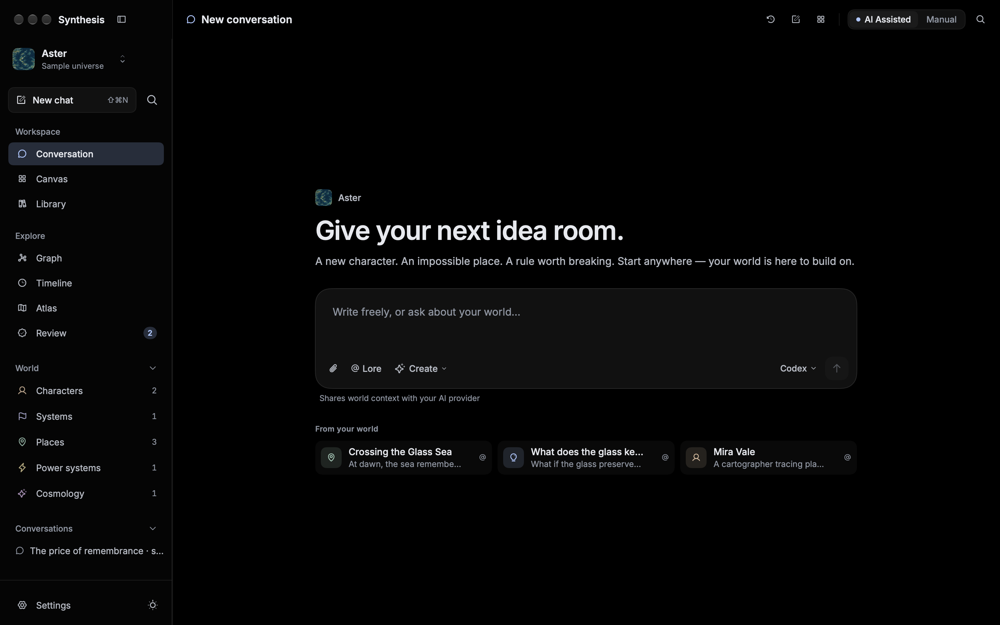
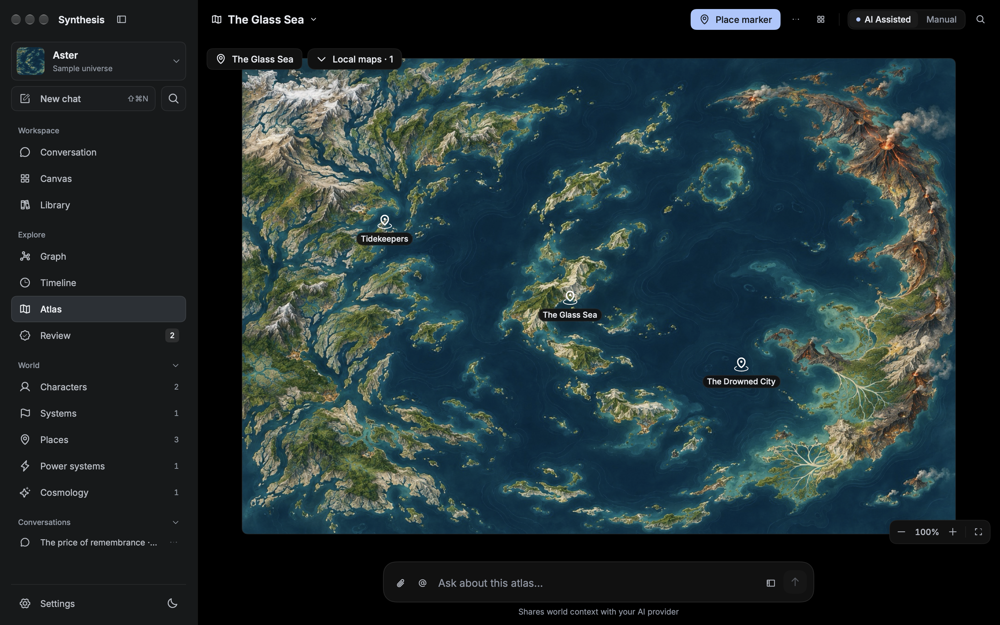

# Synthesis

A native macOS worldbuilding studio built with SwiftUI, AppKit and SQLite. **Conversation, Canvas, Library, Graph, Timeline, Atlas, Review and Worlds** are views of one saved world, sharing one design system.



*Canvas — arrange real world records and explore their relationships.*

<details>
<summary>More app screenshots: Conversation, editor, Graph, Atlas and Settings</summary>

**Conversation** — start with a thought and reference existing lore.



**Editor** — write with linked records, sections and explicit canon review.


**Graph** — explore relationships derived from the same saved world.


**Atlas** — place linked locations on a map. This example uses bundled sample artwork.



**Settings** — searchable preferences for writing, navigation, assistance and each world.


</details>

Screenshots show the actual native development app with the **Aster sample world**, captured at 1440×900. [Capture notes and refresh command](docs/screenshots/README.md).

## Run locally

```sh
export EDITOR=vim VISUAL=vim GIT_EDITOR=vim
./scripts/build.sh release
open dist/Synthesis.app
```

The primary checkout is `/Users/desenyon/Developer/synthesis` on `main`, which is also the GitHub default branch. Build and launch `dist/Synthesis.app` here. Other worktree builds are retired.

Requires macOS 14+ and Swift 6 Command Line Tools. The canvas bundle is committed; Node is only needed to change it (`cd CanvasWeb && npm install && npm run build`). Third-party notices: [THIRD_PARTY.md](THIRD_PARTY.md). [Native Kokonut activity component usage](docs/AI_COMPONENTS.md). Scripts select the compatible installed SDK. This is a development build, ad-hoc signed; no releases or deployment.

## Workspaces

- **Conversation** is the assisted entry point. Pick a mode (Create, Develop, Critique, Simulate, Canonize) and type `@` to reference lore. The shared composer supports attachments and lore references throughout the studio. Actual context retrieval and proposal staging appear in a compact activity list; each answer shows which records were read. When the assistant proposes changes they arrive as a review card: accept or dismiss each record, revision, relationship, event, rule, link or spatial placement; accepted ones become drafts. Chats persist and can be renamed or archived. Without a configured provider the app says so and keeps your message.
- **AI Assisted / Manual** sits in every workspace bar and is independent of navigation. Manual persists, cancels active work and blocks provider requests in the native core. Every other tool keeps working.
- **Canvas** runs on the [Excalidraw](https://github.com/excalidraw/excalidraw) engine: draw freely, add shapes, text, images and frames, and place record cards that stay linked to your library. Relationships between entities appear as labelled arrows, and an arrow you draw between two entity cards can become a relationship. An explicit Arrange action uses Dagre and can be undone; PNG export includes Synthesis card styling and artwork. It works offline; nothing is loaded from the network. Synthesis supplies the visible world-record cards, colored connection ports, image previews and compact toolbars; Excalidraw supplies gestures and history. A compact composer expands into a resizable docked companion that shares the conversation.
- **Graph** uses the open-source Dagre engine to arrange native record cards from entity relationships. Select an entity for its details, edit relationships, or copy a neighbourhood into an editable board.
- **Library** holds every document, entity and idea with full-text search, filters and an archive. The editor has rich text, a details inspector (tags, aliases, links, relationships, timeline) and canon review as a line diff.
- **Timeline** orders sourced events with free-form dates, nested branches and periods. Branches organize alternate histories; they do not duplicate or merge canon. **Atlas** pins records to a map image you supply or explicitly choose from the bundled sample illustration library. Replacing a map offers Undo.
- **Review** gathers what is waiting on you: AI proposals from every conversation, drafts that have moved past accepted canon, and a local consistency check (clashing names, unlinked mentions, unconnected entities) that needs no model.

Nothing is hard-deleted: removing a record, conversation, board, event or relationship archives it and offers Undo. No AI output becomes canon without your explicit acceptance of an exact revision.

## Worlds and setup

Use the world menu → **All worlds** to browse, search, create or open a world. **Save world file** exports a portable `.synthesis` snapshot; opening it creates an independent copy with fresh identifiers and preserved internal links. It includes rich text, images, boards, conversations, proposals, rules and history. The live copy stays in the local SQLite database: saving an archive is an explicit snapshot, not continuous folder synchronization. Files are private world data; they contain no provider credentials.

Markdown, JSON and image-only exports are available from Settings and the File menu. Settings is a searchable workspace with **General, Writing, Assistant, This world and Data** sections. Set text size/reading width, spelling and smart punctuation, word counts, Library previews, sidebar counts/history, launch workspace and Return versus Command–Return to send. New entity types and conversation modes can default per world; these travel in portable world files. Existing rich formatting is preserved. The setup flow appears only for a fresh installation. Codex is recommended; an existing provider choice is preserved. Runtime image generation is not implemented; no image usage occurs automatically.

Every content workspace has the shared contextual composer in Assisted mode. Expand it to read the conversation alongside the current page. The open record is included as context. Manual removes these controls and blocks requests in the core.

## Keys

| Shortcut | Action |
| - | - |
| ⌘K | Search and commands |
| ⌘1 – ⌘7 | Conversation, Canvas, Library, Graph, Timeline, Atlas, Review |
| ⌘O / ⇧⌘S | Open / save a portable world snapshot |
| ⌘8 / ⌘9 | Worlds / Settings |
| ⌘N / ⇧⌘N | New record / new conversation |
| ⇧⌘I | Import Markdown or text files |
| @ in a message | Reference lore; ↑↓ choose, ↵ insert |
| ⌘\ | Toggle navigation |
| ⇧⌘M | Toggle AI Assisted / Manual |
| ⌘[ | Back from a record |
| Canvas | Excalidraw's shortcuts: 1–0 tools, V select, H hand, A arrow, ⌫ delete, ⌘Z undo, ⌘D duplicate, ⌘G group |

The sidebar groups workspaces, world categories and real conversation history. Authored controls use bundled Phosphor icons and Inter typography in both native views and Canvas. The Graph shares stored relationships with Canvas, but keeps its own derived layout.

On Canvas, double-click a card to open its record. Draw an arrow from one entity card to another to propose a relationship. Select cards and choose Reference to mention them in the conversation; Add ▸ Artwork puts a picture on the selected card. "Show on canvas" in a record's menu finds or places its card. Board text is explicitly board-only until you select **Save as idea**, which creates a linked Library record. Selecting a relationship opens its shared native inspector. The assistant can propose a new board, card placement or an Atlas marker; approval flushes and reloads the live scene without discarding other drawings.

## Development checks

```sh
./scripts/check.sh                                # strict lint, tests, optimized build
./scripts/verify-ui.sh docs/verification/latest   # captures every state; stays in the background
./scripts/selftest-ui.sh docs/verification/latest # posts real pointer and key events to the app
uv run --with pillow python scripts/contact-sheets.py docs/verification/latest --prune
```

The native suite (includes the rules backend) covers persistence, world isolation, canon approval, cancellation, reversible archive, audited relationships, retrieval, the proposal approval boundary, import and export, board layout and undo, mention tokens, Markdown parsing, canon diffing and graph layout. Eight additional Node tests cover canvas geometry, relationship state, nested groups and session isolation (`cd CanvasWeb && npm test`). Visual checks use the real native window and bundled WebKit engine, never HTML previews. The background runner builds a temporary app, requires a fresh isolated database and refuses model requests. It does not overwrite the running bundle. Background sheets render their real content inline to avoid modal activation; native modal interaction requires the explicit foreground test. The self-test needs its window to be key for a few seconds and reports skipped checks if focus is taken. Current status is in [STATE](docs/STATE.md); the current audit and limits are in [INTEGRATION_OVERHAUL](docs/INTEGRATION_OVERHAUL.md). Full strict lint, the native suite and optimized build pass on the consolidated checkout. Rules can be added and edited as drafts in system/cosmology details and on entities already holding rules; the dedicated Rules Lab remains unfinished.

The assistant uses only Claude Code or Codex with your subscription. Direct API settings and transport have been removed; see [AI setup](docs/AI_SETUP.md).

Data: `~/Library/Application Support/Synthesis/synthesis.sqlite`, overridable with `SYNTHESIS_DATABASE_PATH`. Subscription credentials stay with Claude Code or Codex; Synthesis does not read or store them. See [AI setup](docs/AI_SETUP.md), [architecture](docs/ARCHITECTURE.md), [design direction](docs/UI_DIRECTION.md), [roadmap](docs/ROADMAP.md).

Typing in ⌘K also offers to capture the text as an idea. Worlds export as a folder of Markdown files or as complete JSON; Markdown and text files import as drafts.

Current limits: Claude’s earlier handoff records one live request per subscription harness; this audit makes no model-provider calls. Live streaming/Stop UI, large boards/graphs, trackpad and VoiceOver remain unverified. PNG export uses engine-rendered cards and does not yet reproduce the DOM card material exactly. Bundled AI-generated sample artwork is optional; on-demand image generation is not implemented. Earlier evidence under `docs/verification` is historical.

To build a separate review bundle without replacing a running app: `./scripts/build.sh release dist/Synthesis-review.app`. Use the primary checkout above; historical worktree paths in old verification logs are not current launch targets.

Audit repairs are tracked in [AUDIT.md](docs/AUDIT.md) and [PROGRESS.md](docs/PROGRESS.md), with per-item native captures. Entity sections remain searchable but have their own Library filter; entities open on Overview and remember the selected tab for the session. Saved `Factions` categories display as **Systems** without altering their stored value. Canvas Fit reserves space for its composer and tools.

The current audit has completed 19 items; A2 still needs its live Canvas theme check, and C2/C3 are excluded pending owner approval. Worlds now shows saved covers and activity with editable descriptions. Timeline can create an event in an empty world with its source draft. Markdown export preserves supported rich formatting and entity sections. Settings now uses searchable sections and individually explained import/export actions; provider details stay behind a disclosure. See [STATE](docs/STATE.md) for exact verification limits, including the unrun foreground modal test.

Creative components let you add notes, facts, checklists and progression tracks to workspaces and entity pages. They are ordinary versioned lore, usable in Manual mode and available to reviewed assistant proposals. [Usage and data contract](docs/CREATIVE_COMPONENTS.md).
