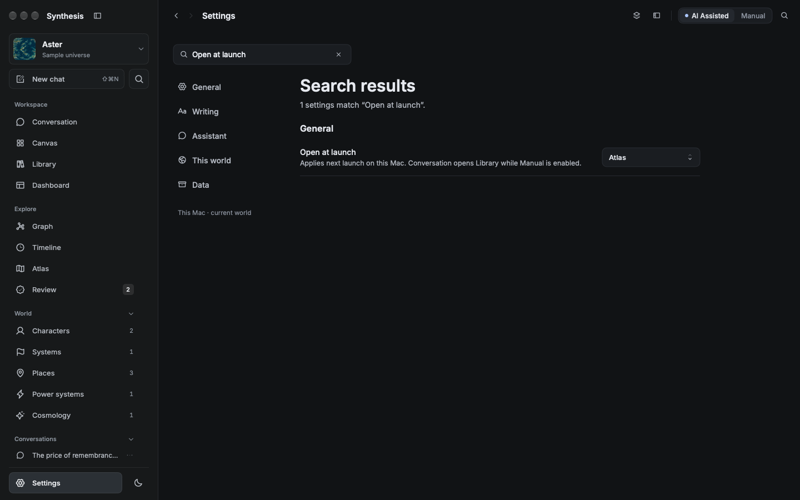

# Choose a starting workspace

Open **Settings → General → Open at launch**. Choose Last workspace, Conversation, Atlas, Dashboard, Canvas, Library or Your worlds. The change applies the next time Synthesis opens; it does not interrupt current work.

This is a device preference. It follows the last selected universe, is not included in portable world files and does not change any lore. Atlas and Canvas remain genuinely empty when the selected universe has no maps or boards.

Last workspace follows sidebar, direct conversation, board, search and Back/Forward navigation. Companion conversations keep the underlying workspace. A failed pending document save prevents navigation and leaves the remembered destination intact.

Manual stays Manual on restart. Choosing Conversation opens Library while assistance is disabled; the saved home preference remains Conversation for a future assisted launch. Opening any home never submits a model request. Invalid older preference values fall back to Last workspace, then Conversation in Assisted mode or Canvas in Manual if no remembered workspace exists.

This setting chooses the initial workspace. Full restoration of every open view, selection and draft is tracked separately in expansion #33.

